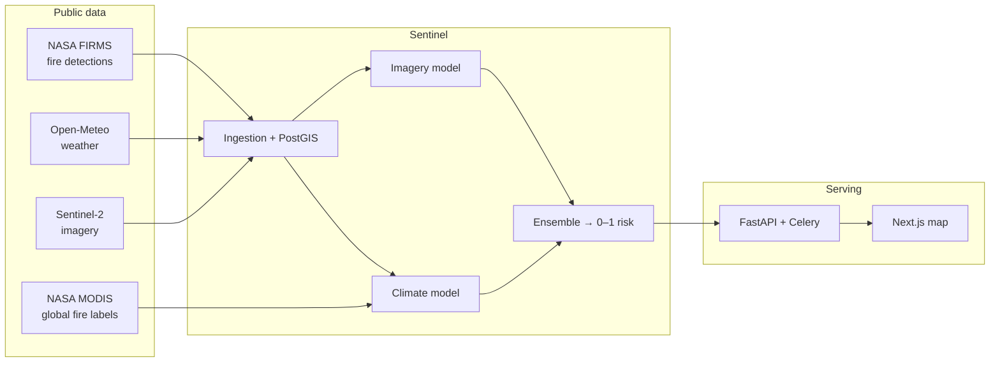
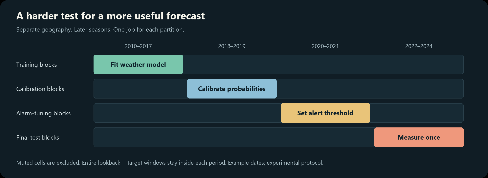

<div align="center">

# Sentinel

### Wildfire risk forecasting engine

**A wildfire forecasting research system combining satellite imagery and climate
sequences, with an interactive risk map and reproducible model evaluation.**

[](https://github.com/Blasted-ctrl/Sentinel/actions/workflows/ci.yml)


</div>

---

## What it does

Sentinel turns public earth-observation data into a **0–1 model score** and serves
it through an interactive map. The API accepts global coordinates; the existing
models have not demonstrated calibrated ignition probabilities at arbitrary
locations. Treat the map as a research interface.

- **Global.** Click anywhere on the map to score that exact location on demand, or
  browse pre-scored fire-prone regions across every continent.
- **Measured models.** Satellite-imagery and climate-sequence models are fused
  into a score. The legacy metrics below come from committed `metrics.json`
  files with disjoint grid-cell regions; they do not test future seasons or
  prove point-level probability calibration.
- **Stricter training experiments.** A CPU benchmark separates model fitting,
  calibration, alarm tuning, and testing across both geography and time, with
  a seasonal baseline and explicit probability-error metrics.
- **Production-shaped.** Geospatial database, streaming ingestion, a typed API,
  scheduled re-scoring, and a polished dashboard.

## Architecture



## Tech stack

| Layer | Tools |
| --- | --- |
| Models | PyTorch, TensorFlow / Keras, scikit-learn |
| Backend | FastAPI, Celery, SQLAlchemy 2.0, GeoAlchemy2 |
| Data | PostgreSQL + PostGIS, Redis, S3 / MinIO |
| Frontend | Next.js + TypeScript, Leaflet |
| Tooling | uv, ruff, mypy, pytest, Docker, GitHub Actions |

## Model performance

> **Legacy retrospective results**, read from committed `metrics.json` files.
> Grid-cell groups are held out, with RNG seeds recorded. These are different
> tasks and sampled populations, so the tables are not directly comparable.

**Satellite-imagery model** — classifies tiles as fire / no-fire (ResNet-18
transfer learning, 402 grid-cell regions, held-out test set):

| Recall | Precision | F1 | ROC-AUC | False-alarm |
| --- | --- | --- | --- | --- |
| **0.989** | 0.863 | 0.922 | 0.981 | 0.161 |

**Climate model (global)** — predicts active-fire occurrence within 7 days from
a 14-day weather sequence, trained on **200 fire-active regions worldwide**,
labelled by NASA MODIS detections. Detections can include ongoing fires and do
not establish ignition times. Approximately **70.5% of test windows are positive**
in this selected population:

| ROC-AUC | Recall | Precision | F1 | False-alarm |
| --- | --- | --- | --- | --- |
| **0.85** | 0.85 | 0.86 | 0.85 | 0.33 |

**Ensemble** — a logistic meta-model fuses the two signals, scored on 29 held-out
global regions:

| Variant | ROC-AUC | Recall | False-alarm |
| --- | --- | --- | --- |
| Climate only | 0.854 | 0.847 | 0.335 |
| **Ensemble** | 0.826 | 0.805 | **0.287** |
| Imagery only | 0.620 | 0.168 | 0.065 |

The ensemble has lower false alarms at the reported threshold, but also lower
recall and ROC-AUC than the climate model. That tradeoff does not establish that
fusion improves forecasting. Imagery timing, natural event prevalence, future
years, and calibration need separate validation.

## Training for reliability



The experimental `prepare-climate` → `train-reliable-climate` path uses a fixed
FPA-FOD grid with all available non-event windows. It purges overlapping input
and label periods, gives each training region equal total weight, calibrates on
untouched regions/years, then selects an alarm threshold on a separate partition.
The final test reports average precision, Brier score, log loss, calibration bins,
and regional results alongside a seasonal baseline.

- [Dataset shortlist and acquisition guidance](docs/datasets.md): FPA-FOD 7
  (through 2024), Mesogeos, IberFire, SeasFire, VIIRS, burned-area products,
  ERA5-Land, CEMS fire-danger indices, and WildfireSpreadTS, with task and access
  constraints.
- [Commands, evaluation protocol, and research proposal](docs/training.md): a
  disagreement-aware, season-matched curriculum to test against ordinary LSTM
  training, with prespecified ablations. This proposal is **not yet implemented
  or validated**.

The new CPU path has synthetic regression/smoke coverage. A real FPA-FOD 7
archive was checksum-verified locally; the attempted weather preparation was
rate-limited by Open-Meteo before producing a training cache. **No new real-data
model results or serving weights are claimed by this change.**

## Run it locally

```bash
# 1 — infrastructure
docker compose up -d db redis                      # PostGIS + Redis

# 2 — API
cd backend
uv sync --extra dev --extra torch --extra tf       # provisions Python 3.12 + deps
uv run sentinel init-db                            # enable PostGIS + create tables
uv run sentinel seed-demo --score                  # seed + score global regions
uv run uvicorn sentinel.api.app:app --port 8000    # http://localhost:8000/docs

# 3 — dashboard
cd ../frontend
pnpm install
echo "NEXT_PUBLIC_API_URL=http://localhost:8000" > .env.local
pnpm dev                                            # http://localhost:3000
```

The `sentinel` CLI includes `train-cnn`, `train-lstm`, `train-lstm-global`, and
`build-ensemble`; each writes metrics to its configured output directory. The
experimental `prepare-climate` and `train-reliable-climate` commands need only
the base scientific stack (`uv sync --extra dev --frozen`), without PyTorch or
TensorFlow. Source accounts, attribution, and API limits vary; see the dataset
guide before downloading.

## API

```bash
docker compose up -d        # db, redis, minio, api, worker, beat
```

| Endpoint | Description |
| --- | --- |
| `GET /health` | liveness + version |
| `GET /risk/point?lat=&lon=&date=` | score **any point on Earth** on demand |
| `GET /risk/geojson` | regions + latest scores (feeds the map) |
| `GET /risk?region=<id\|name>&date=` | a tracked region's score |
| `GET /risk/latest` | latest score per region |

The web process stays lightweight — it serves scores that a **Celery** worker
computes and stores in PostGIS, re-scoring every tracked region daily.

`docker-compose.yml` runs the whole stack locally in one command.

## License

MIT
