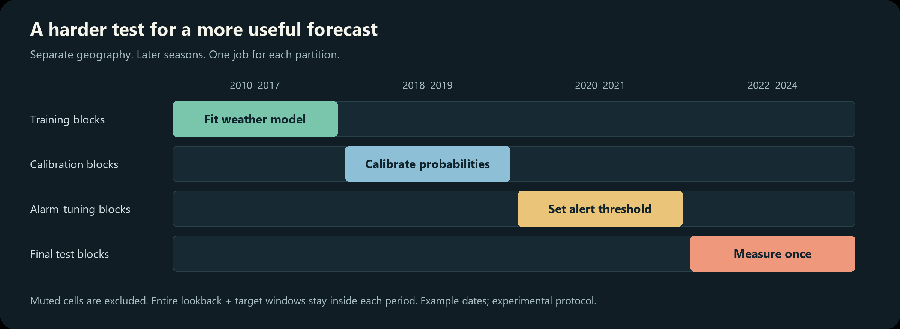

# Reliability experiments

The serving CNN/LSTM ensemble is an existing retrospective research model.
Its geospatial test is useful, but does not establish calibrated global ignition
probabilities. The new `train-reliable-climate` command is an experimental CPU
benchmark; its name describes the evaluation objective, not a reliability claim.
It writes separate artifacts and does not replace serving weights.



## Implemented protocol

The benchmark uses existing scikit-learn components with no additional dependency:

1. Select a fixed spatial grid without reading fire outcomes. Assign coarse
   spatial blocks to train / calibration / alarm tuning / test by seeded,
   label-blind permutation (approximately 55 / 15 / 15 / 15 percent of blocks).
2. Keep only the corresponding chronological interval in each partition. For a
   window ending at `t`, the entire interval `[t-lookback+1, t+horizon]` must fit
   within its period. Boundary windows are purged, preventing either features
   or target horizons from crossing a period boundary. Missing calendar days
   also invalidate windows; duplicate weather dates fail explicitly.
3. Fit a small histogram gradient-boosted model to recent, mean, min, max, and
   first-to-last weather features. Each training region receives equal total
   weight, so long records cannot dominate. Internal random early stopping is
   disabled. Hyperparameters are fixed before the test.
4. Fit a sigmoid calibration model on later, unseen blocks at their observed
   prevalence. No class balancing is applied to calibration data.
5. Set the highest alarm threshold meeting the requested recall on a third
   region/time partition. This is a tuning constraint, **not a test-recall
   guarantee**. A seasonal logistic model gets its own alarm threshold on the
   same tuning data, providing a simple comparison.
6. Evaluate once on the final region/time partition: average precision, ROC-AUC,
   Brier score, log loss, recall, precision, false-alarm rate, and populated
   probability-reliability bins. Report region metrics where both classes are
   present and list all single-class test regions explicitly.

Calibration can worsen under geographic or temporal shift. Inspect both raw and
calibrated probability errors; the report does not assume calibration succeeded.
There is no automatic promotion based on a favorable test number.

## Prepare and train

Download and extract the SQLite file from the [FPA-FOD 7 archive](https://www.fs.usda.gov/rds/archive/catalog/RDS-2013-0009.7).
From `backend/` (all date boundaries below are declared before evaluation):

```bash
uv sync --extra dev --frozen
uv run sentinel prepare-climate \
  --fod-sqlite data/FPA_FOD_20260615.sqlite \
  --citation https://doi.org/10.2737/RDS-2013-0009.7 \
  --region=-124,32,-104,48 --cell-size 2 --block-size 4 \
  --start 2010-01-01 --end 2024-12-31 \
  --output data/fod_west_climate.npz

uv run sentinel train-reliable-climate \
  --data data/fod_west_climate.npz \
  --train-end 2017-12-31 --calibration-end 2019-12-31 \
  --tune-end 2021-12-31 --min-recall 0.90 --seed 42 \
  --output artifacts/reliable-climate
```

Preparation pins the Open-Meteo archive to **ERA5**, avoiding the default blend
of weather models across years. It makes one multi-year request per cell, with
the existing client's delay and retry policy. Multi-year requests count as many
API calls; the example can exceed free-tier minute/hour/day budgets. Provision
adequate data access or stage a smaller study before attempting it. See
[Open-Meteo's historical API](https://open-meteo.com/en/docs/historical-weather-api)
and [weighted-call guidance](https://openmeteo.substack.com/p/weather-data-for-multiple-locations).
A completed cache permits repeated offline
training. The command currently writes the final cache only after all requests
finish; interruption requires rerunning preparation. Budget API use accordingly.
Fewer than eight spatial blocks, an empty purged partition, or a single-class
partition fails with a useful error. Expand the study instead of searching for
a favorable test seed.

Outputs are `climate.joblib` (estimator, calibrator, threshold, feature order,
lookback, horizon), `metrics.json` (protocol, provenance, cache SHA-256, library
version, split membership/counts, metrics), and `test_predictions.npz` for audit.
Load only trusted joblib artifacts. To score new windows, apply the same cache
feature order and `summarize_windows`, then feed the estimator's
`decision_function(...).reshape(-1, 1)` into the saved calibrator's
`predict_proba(... )[:, 1]`. Production integration remains a separate decision.

## Sentinel-specific research hypothesis

**Try a disagreement-aware, season-matched curriculum after this baseline.**
This is a proposed experiment, not an implemented neural objective or a claim of
scientific priority. Spatial/temporal holdouts, calibration, and stratified
negative sampling already have substantial precedent; see
[Kondylatos et al.](https://doi.org/10.1029/2022GL099368),
[calibrated fire-occurrence models](https://doi.org/10.1071/WF20139), and
[scikit-learn's calibration guidance](https://scikit-learn.org/stable/modules/calibration).

The hypothesis: Sentinel can reduce dry-season false alarms by learning to
distinguish similar fuel/weather conditions with different observed outcomes,
while keeping **discovery** and **ongoing-fire detection** as separate targets.

1. Warm up the climate encoder on all covered FPA-FOD windows, retaining natural
   occurrence prevalence and equal total region weight.
2. In training blocks only, pair discovery windows with hard non-event windows
   from the same month, fuel class, and ecoregion, but a different incident and
   nonoverlapping time interval. Mine these pairs from out-of-fold predictions;
   never from final test errors. Compare an auxiliary pair-ranking loss against
   ordinary binary cross-entropy. A non-event is an observational control, not
   proof of safe conditions.
3. Add a separate auxiliary active-fire head using VIIRS/MODIS observation
   masks. Disagreement between source labels informs quality masks / auxiliary
   supervision; never erase a reported FPA-FOD discovery just because a satellite
   missed it. Do not feed post-discovery fire masks into the ignition head.
4. Remove the training sampler and calibrate at natural prevalence on untouched
   regions/years. Tune the alarm threshold separately as in the implemented
   benchmark. Audit weather missingness, smoke/cloud cover, sensor changes, and
   archived forecast latency as distinct stress cases.

Pre-register ablations: seasonal baseline; boosted benchmark; ordinary LSTM;
LSTM + matched pairs; LSTM + auxiliary detection; both additions. Use the same
frozen partitions, then repeat on predeclared rolling-year / leave-region-out
folds reserved for development. Keep an additional untouched final period for
any winner selected across experiments. Compare average precision, Brier and
log loss, and false alarms at a fixed tuning-recall target; use spatial-block
bootstrap intervals rather than treating overlapping windows as independent.
The additions earn their complexity only if gains persist across those checks.

## Limits before deployment

The example grid is coarse and US-only. Reporting gaps, initially zero-filled
weather nulls, centroid weather, grid boundaries, and discovery-date uncertainty
remain limitations. Reanalysis is retrospective and may include observations
unavailable at issue time. An FPA-FOD negative is no reported event, not a
coverage guarantee. Smaller fuel-masked grids, archived operational inputs,
source-quality masks, geographic buffer sensitivity, multiple prespecified
folds, uncertainty intervals, and a prospective shadow run are still required
before claiming trustworthy point-level risk. A single held-out benchmark does
not establish global reliability.
